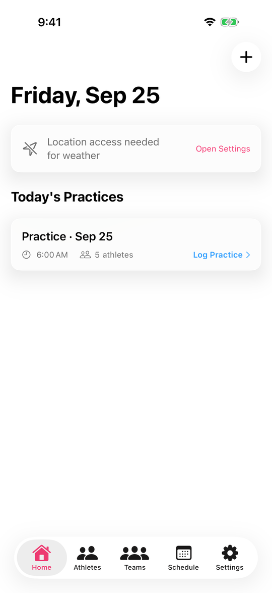
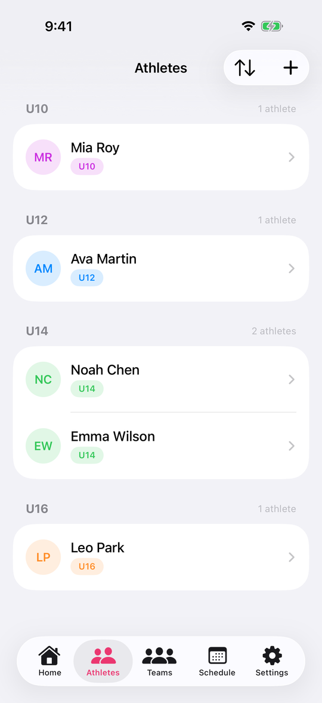
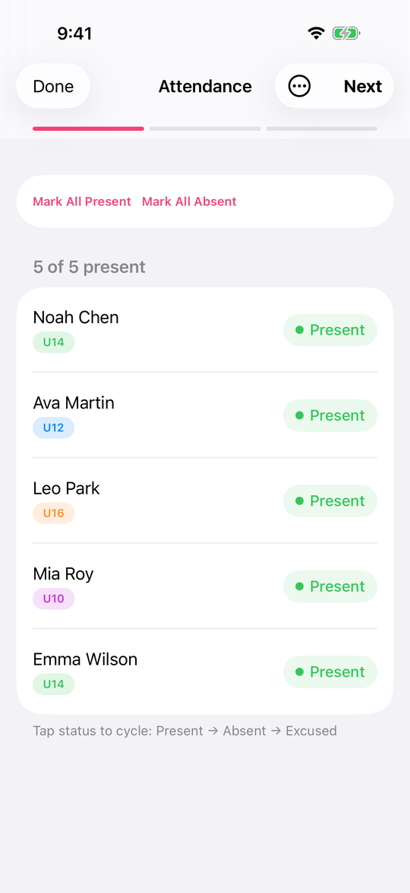
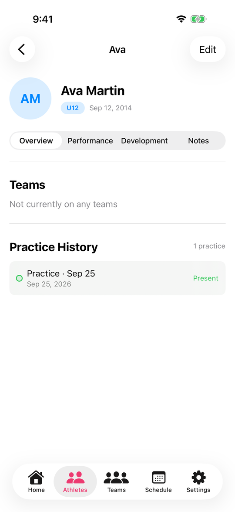
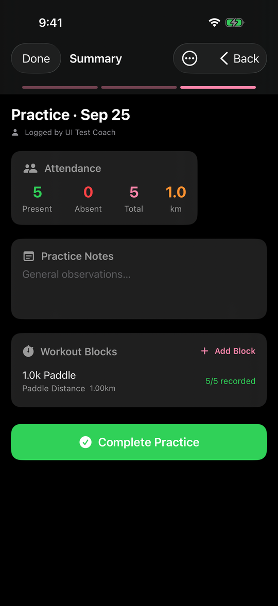

# CoachSync

CoachSync is a SwiftUI and SwiftData app for youth paddling coaches. It tracks athletes, teams, training sessions, attendance, performance times, technical assessments, fitness tests, regatta results, and season summaries.

A companion **Spring Boot backend** (under [`backend/`](backend/README.md)) acts as the shared
club store the app syncs through, enabling coaches on different Apple IDs to share one club.

## Screenshots

  
  
  
  
  

All names and data shown are fictional.

## Getting started

- **Build & run** (app and backend): [`SETUP.md`](SETUP.md)
- **Backend** (API, local run, Swagger docs): [`backend/README.md`](backend/README.md)

## Targets

- `CoachSync/` contains the main iOS app.
- `CoachSyncMac/` contains the macOS target, which mostly reuses the same feature views.

## Architecture

The project is a small SwiftUI app with a single shared SwiftData model layer.

- UI is organized mostly by feature screen rather than by formal modules.
- `CoachSyncApp.swift` and `CoachSyncMacApp.swift` create the `ModelContainer` and register the schema.
- `Models.swift` defines the domain model and most persistence relationships.
- `ContentView.swift` and `MacContentView.swift` define top-level navigation.
- Most screens read and write models directly using `@Query`, `@Bindable`, and `@Environment(\.modelContext)`.
- Reusable UI pieces live in `Components/`.
- Small shared formatting helpers live in `Extensions/` and utility files like `TimeParsing.swift`.

This is intentionally a pragmatic app structure rather than a layered architecture. Most logic lives close to the screen that uses it.

## Main Navigation

### iOS

`ContentView.swift` hosts the tab bar:

- `DashboardView`
- `AthletesView`
- `TeamsView`
- `ScheduleView`
- `SettingsView`

### macOS

`MacContentView.swift` hosts a sidebar with the same major destinations:

- Dashboard
- Athletes
- Teams
- Schedule
- Settings

## Data Model Overview

The core entities are:

- `Athlete`
  - Stores athlete profile data.
  - Owns memberships, attendance, performance records, notes, fitness tests, regatta results, and technical assessments.
- `Team`
  - Groups athletes for rostering and scheduling.
  - Owns `TeamMembership` records.
  - Keeps linked `CoachSession` records via `nullify`, so deleting a team does not necessarily delete session history.
- `TeamMembership`
  - Represents an athlete being on a team over time.
  - `leftDate == nil` means the membership is still active.
- `CoachSession`
  - Represents a scheduled or completed training session.
  - Owns blocks, attendance records, and session-scoped athlete notes.
- `SessionBlock`
  - Represents one workout block inside a session.
  - Owns performance records and block-scoped notes.
- `PerformanceRecord`
  - Stores one athlete’s result for one repetition in one session block.
  - Supports timed results as well as `DNS` and `DNF`.
- `FitnessTestResult`
  - Stores named fitness testing results per athlete.
- `RegattaResult`
  - Stores competition results per athlete and distance.
- `TechnicalAssessment`
  - Stores a snapshot assessment for an athlete at a development stage.
  - Owns `TechnicalRating` child records.
- `SeasonArchive`
  - Stores season summary metrics when completed sessions are archived.

## Feature Map

### Dashboard

`DashboardView.swift`

- Shows today’s sessions, upcoming sessions, and recent completed sessions.
- Opens `SessionLoggerView` to log a session.
- Creates new sessions through `AddSessionSheet`.

### Athletes

`AthletesView.swift`

- Lists active athletes grouped by age category.
- Supports search, creation, and deletion.
- Opens `AthleteProfileView`.

`AthleteProfileView.swift`

- Central athlete detail screen.
- Brings together summary sections for:
  - teams
  - attendance history
  - performance trends
  - fitness tests
  - regatta results
  - technical assessments
  - notes
  - training load

Related files:

- `EditAthleteSheet.swift`
- `FitnessTestView.swift`
- `RegattaResultsView.swift`
- `TechnicalAssessmentView.swift`
- `NewAssessmentView.swift`

### Teams

`TeamsView.swift`

- Lists active and archived teams.
- Opens `TeamDetailView`.

`TeamDetailView` inside `TeamsView.swift`

- Shows roster management.
- Adds and removes athletes through membership records.
- Shows weekly and seasonal training load summaries for a team.
- Team load is based on completed sessions rather than planned future work.

### Schedule

`ScheduleView.swift`

- Shows a month grid and sessions on the selected day.
- Opens `SessionLoggerView`.
- Supports creating, editing, and deleting sessions from the calendar flow.

### Session Logging

`SessionLoggerView.swift`

This is the main workflow-heavy file in the project.

It drives a multi-step process:

1. Attendance
2. Block entry
3. Summary and completion

Key behaviors:

- If a session is still `scheduled`, opening the logger marks it `inProgress`.
- Attendance is collected first and saved into `AttendanceRecord`.
- Reopening the logger reuses saved attendance instead of resetting everyone to present.
- Only athletes marked present move into block data entry.
- Performance data is stored per athlete, per block, per repetition.
- Completing the flow marks the session `completed` and stamps an end time.

### Settings and Admin

`SettingsView.swift`

- Manages club name
- Shows app stats
- Imports athletes from CSV
- Archives seasons
- Clears session data or resets all app data

Related files:

- `CSVImportView.swift`

## Reusable UI

`Components/`

- `CategoryPill.swift`
- `StatusPill.swift`
- `EmptyCard.swift`
- `SectionHeader.swift`
- `Color+AgeCategory.swift`

These provide shared display conventions used across multiple screens.

## Utility Files

- `TimeParsing.swift`
  - Shared formatting and parsing helpers for race and training times.
  - Accepts fractional seconds with one to three digits and normalizes them to milliseconds.
- `Extensions/String+Ordinal.swift`
  - Formats values like `1st`, `2nd`, `3rd`.

## Important Project Conventions

- Age category is derived from birth year, not exact birthday.
- Team membership is historical; removing an athlete from a team usually means ending a membership, not deleting it.
- Recovery-zone distance is often displayed but excluded from training load summaries.
- Archived sessions are hidden from active views like Dashboard and Schedule but still contribute to preserved historical records where relevant.

## Files Worth Reading First

For a fast project walkthrough, read in this order:

1. `CoachSync/CoachSyncApp.swift`
2. `CoachSync/ContentView.swift`
3. `CoachSync/Models.swift`
4. `CoachSync/DashboardView.swift`
5. `CoachSync/AthletesView.swift`
6. `CoachSync/AthleteProfileView.swift`
7. `CoachSync/ScheduleView.swift`
8. `CoachSync/SessionLoggerView.swift`
9. `CoachSync/SettingsView.swift`
10. `CoachSync/TeamsView.swift`

## Notes

- The macOS target still includes some Xcode-generated scaffolding, but the main app logic is in the shared CoachSync files.
